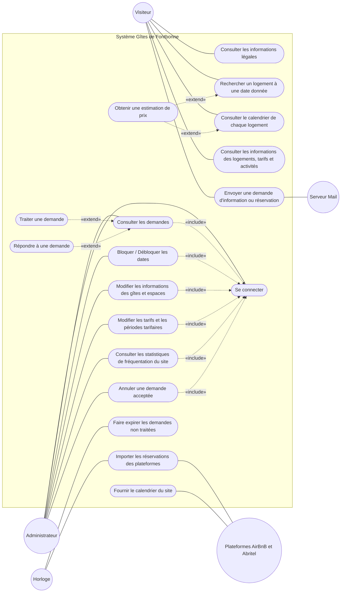
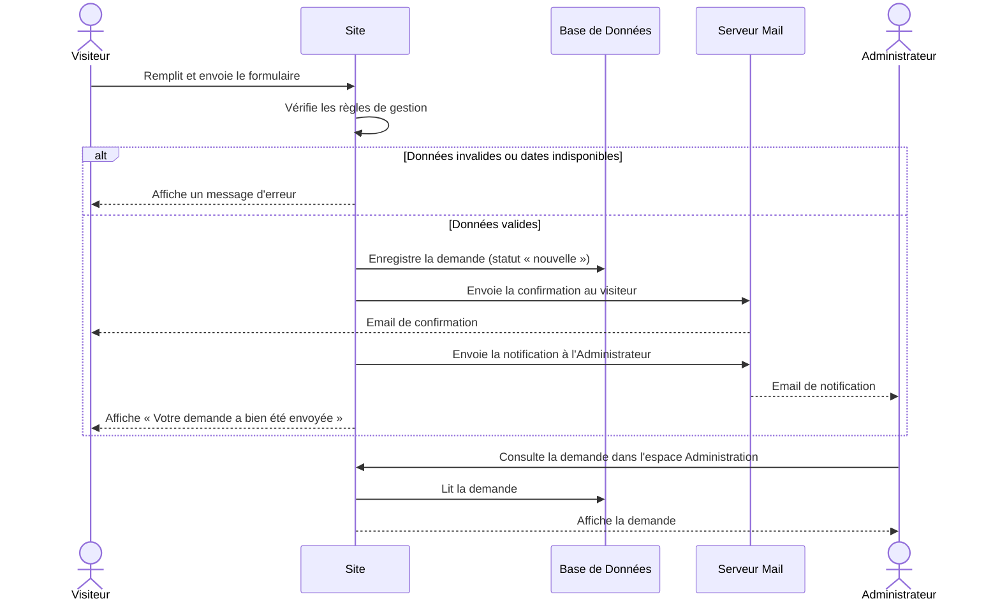

# Cahier des charges fonctionnel

>Cartes du projet : [#1](https://github.com/Milie07/gites-de-fontbonne/issues/1), [#2](https://github.com/Milie07/gites-de-fontbonne/issues/2), [#3](https://github.com/Milie07/gites-de-fontbonne/issues/3)

---

## Sommaire
1. [Contexte](#1-contexte)
2. [Analyse de l'existant](#2-analyse-de-lexistant)
3. [Besoins et Objectifs](#3-besoins-et-objectifs)
4. [Périmètre](#4-périmètre)
5. [Acteurs (v1)](#5-acteurs-v1)
6. [Exigences Fonctionnelles (v1)](#6-exigences-fonctionnelles-v1)
7. [Exigences non fonctionnelles](#7-exigences-non-fonctionnelles)
8. [Règles de gestion (v1)](#8-règles-de-gestion-v1)
9. [User Stories](#9-user-stories)
10. [Diagrammes](#10-diagrammes)
11. [Validation](#11-validation)
    
---

## 1. Contexte
  ### 1.1 L'entreprise et les gîtes
L'EURL "Les Sources de Fontbonne" exploite "les Gîtes de Fontbonne" : 3 gîtes de vacances regroupés dans le hameau de Fontbonne, au cœur de l'Ardèche verte.

Les 3 gîtes sont indépendants. Chacun dispose de 5 couchages et est entièrement équipé pour que les vacanciers soient autonomes. Ils partagent une piscine extérieure, une salle de jeux et un espace spa équipé d'un sauna et d'un jacuzzi.

Une chambre avec salle d'eau (douche et toilettes) peut être louée en complément de l'un des gîtes. Elle n'est pas réservable seule et n'apparaît pas sur les plateformes de location.

Les propriétaires vivent sur place, à l'entrée du hameau, ce qui laisse aux vacanciers l'impression d'être seuls à Fontbonne.

  ### 1.2 La clientèle
Les vacanciers sont pour la plupart des familles, des groupes d'amis, des randonneurs ou des vététistes. Il arrive aussi qu'un seul groupe loue l'ensemble des gîtes pour se retrouver.

Ils recherchent avant tout la déconnexion, la tranquillité et la nature. Ils réservent en général pour un week-end ou à la semaine.

  ### 1.3 La présence en ligne actuelle
Le site www.gitesdefontbonne.com a été créé en 2012 par les anciens propriétaires avec WordPress, et il est hébergé chez Ionos. Les propriétaires actuels l'ont ensuite mis à jour.

Les Gîtes de Fontbonne sont aujourd'hui visibles en ligne par 3 canaux :

- le site WordPress gitesdefontbonne.com ;
- les annonces Airbnb et Abritel ;
- une fiche d'établissement Google, qui affiche la note de 5/5 sur 13 avis (novembre 2026) et dirige les visiteurs vers le site.

La refonte doit préserver cette visibilité : le lien de la fiche Google vers le site, la cohérence des informations (nom, adresse, téléphone) et le référencement existant.

[↑ Haut de page](#cahier-des-charges-fonctionnel)

---

## 2. Analyse de l'existant
  ### 2.1 Constats sur le site actuel (réalisé en novembre 2026)

Audit PageSpeed Insights du 12/11/2026 :

| | Performance | Accessibilité | Bonnes pratiques | SEO |
|---|---|---|---|---|
| Ordinateur | 88 | 87 | 69 | 92 |
| Mobile | 50 | 88 | 69 | 92 |

- Sur mobile, l'élément principal de la page s'affiche en 91,4 s (seuil "bon" de Google : 2,5 s).
- La page d'accueil pèse environ 33 Mo, surtout à cause d'images non optimisées.
- 32 ressources sont chargées sans connexion sécurisée, et aucun en-tête de sécurité n'est en place.
- Les contrastes sont insuffisants et certains liens n'ont pas de nom accessible.
- Les pages n'ont pas de méta-description.
- Le tableau des tarifs s'affiche mal, sur mobile comme sur ordinateur.
- Le site n'a pas d'identité visuelle : fond blanc, texte noir et photos.
- Aucun calendrier n'affiche les disponibilités des gîtes en lien avec Airbnb et Abritel.

  ### 2.2 Pourquoi changer 
- **Des visiteurs perdus sur mobile** :

Avec un affichage de plus d'une minute sur une connexion mobile lente, un visiteur repart avant d'avoir vu les logements. Ce sont autant de demandes de réservation en moins.
- **Un référencement fragilisé** :

Google classe les sites principalement d'après leur version mobile. La lenteur et l'absence de méta-description pénalisent la visibilité, malgré un score SEO technique correct.
- **Un risque pour la sécurité et la réputation** :

Ressources non sécurisées, absence d'en-têtes de sécurité, failles fréquentes dans les extensions WordPress : le site peut exposer les données des visiteurs et nuire à l'image des gîtes.
- **Des visiteurs exclus** :

Les contrastes insuffisants et les liens sans nom rendent le site difficile à utiliser pour les personnes malvoyantes ou utilisant un lecteur d'écran.
- **Une image qui ne reflète pas celle des gîtes** :

Un site sans identité visuelle et un tableau des tarifs illisible ne donnent pas envie de réserver.

[↑ Haut de page](#cahier-des-charges-fonctionnel)

---

## 3. Besoins et objectifs
  ### 3.1 Besoins du client
L'EURL "Les Sources de Fontbonne" souhaite disposer d'un site et d'un espace d'administration permettant de :

- refléter l'image du lieu grâce à une identité visuelle propre ;
- présenter chaque logement (gîtes et chambre) avec un descriptif, des photos, un tarif moyen ;
- afficher les tarifs selon les périodes ;
- afficher, pour chaque logement, un calendrier des disponibilités synchronisé avec Airbnb et Abritel ;
- estimer le prix d'un séjour selon les dates choisies ;
- recevoir des demandes d'informations ou de réservation par message ;
- gérer en autonomie, sans intervention technique, les informations des logements (textes, photos, tarifs) ;
- suivre la fréquentation du site ;
- être trouvé facilement sur Google et consultable rapidement sur mobile, y compris par les personnes en situation de handicap.
- Répondre aux demandes des visiteurs depuis l'espace d'administration

  ### 3.2 Objectifs de la refonte
L'objectif principal est de créer un site moderne, performant et accessible, qui permette au visiteur de trouver rapidement l'information qu'il recherche.

  1. Un site rapide sur mobile : élément principal affiché en moins de 2,5 s ;
  2. Un site sécurisé et maîtrisé, sans dépendance à des extensions tierces ; 
  3. Un site accessible : contrastes conformes, éléments correctement nommés ;
  4. Une identité visuelle propre aux Gîtes de Fontbonne ;
  5. Des tarifs et des disponibilités clairs, à jour et lisibles sur tout écran ;
  6. Un référencement préservé pendant la migration, puis amélioré ;

  ### 3.3 Contraintes
- **Synchronisation des calendriers** : les plateformes mettent à jour leurs calendriers toutes les deux heures environ. Les disponibilités affichées seront donc indicatives et confirmées par le propriétaire ;
- **Hébergement** : le site reste hébergé chez Ionos, où se trouve déjà le nom de domaine ;
- **Délai** : mise en ligne avant fin février 2027, avant la saison ;
- **Réglementation** : RGPD et mentions légales ;

[↑ Haut de page](#cahier-des-charges-fonctionnel)

---

## 4. Périmètre 

  ### 4.1 Première version
Les besoins listés dans la partie **Besoins du Client**.
Les exigences de priorité M et celles de priorité S si le temps le permet.

  ### 4.2 Évolutions envisagées (hors périmètre de la première version)
+ Réservation directe en ligne ;
+ Création des contrats de location depuis l'espace admin et envoi au locataire ;
+ Mise à disposition des documents d'arrivée : livret d'accueil, règlement intérieur, informations sur la taxe de séjour ;
+ Paiement en ligne, avec envoi automatique des e-mails d'acompte, de solde et de confirmation de réception ;
+ Avec la réservation en ligne : conditions générales de vente complètes (paiement, annulation, absence de droit de rétractation pour une location à date fixe, médiation de la consommation) ;
+ Espace client facultatif
+ Ecran de gestion des adresses iCal
+ Réception des réponses des visiteurs dans l'admin
+ Envoi automatique de la confirmation de réservation
  
[↑ Haut de page](#cahier-des-charges-fonctionnel)

---

## 5. Acteurs (v1)
| Acteur	| Description |
|---|---|
| **Visiteur**	| Personne qui consulte le site : découvre les gîtes, vérifie les disponibilités, estime un prix, envoie une demande |
| **Administrateur**	| Propriétaire des gîtes : gère les demandes, les tarifs et les informations du site |
| **Airbnb et Abritel**	| Systèmes externes : fournissent les calendriers de réservation au format iCal |
| **Serveur d'envoi d'email**	| Système externe : achemine les e-mails de demande et de confirmation |
| **Horloge**	| Tâche planifiée du serveur :  déclenche à intervalles réguliers l'import des calendriers des plateformes et l'expiration des demandes non traitées.

[↑ Haut de page](#cahier-des-charges-fonctionnel)

## 6. Exigences fonctionnelles (v1)

| N° | Domaine | Exigence | Priorité |
|---|---|---|---|
| EX-01 | Présentation | Le visiteur peut consulter chaque gîte et la chambre : descriptif, photos, capacité, équipements. | M |
| EX-02 | Présentation | Le visiteur peut consulter les activités sur place : piscine, salle de jeux, spa. | M |
| EX-03 | Présentation | Le visiteur peut consulter les activités à proximité. | M |
| EX-04 | Présentation | Le visiteur peut consulter les tarifs à la nuitée. | M |
| EX-05 | Présentation | L'administrateur peut modifier les informations et les photos des logements et des espaces communs. | M |
| EX-06 | Disponibilités | Le visiteur peut consulter le calendrier des disponibilités de chaque logement. | M |
| EX-07 | Disponibilités | Le visiteur peut choisir d'afficher de 1 à 4 calendriers en même temps. | M |
| EX-08 | Disponibilités | Le visiteur peut rechercher les logements disponibles pour des dates données. | S |
| EX-09 | Disponibilités | Le site importe automatiquement les réservations Airbnb et Abritel de chaque gîte. | M |
| EX-10 | Disponibilités | Le site exporte ses propres blocages vers Airbnb et Abritel. | S |
| EX-11 | Disponibilités | Les adresses iCal des gîtes sont configurées en dehors du code source (variables d'environnement) | M |
| EX-12 | Disponibilités | L'administrateur peut bloquer et débloquer des dates pour chaque logement. | M |
| EX-13 | Tarifs | Le visiteur peut obtenir une estimation du prix pour un ou plusieurs logements et des dates choisis. | M |
| EX-14 | Tarifs | L'administrateur peut gérer les tarifs et les périodes tarifaires. | M |
| EX-15 | Demandes | Le visiteur peut envoyer une demande d'information ou de réservation pour un ou plusieurs logements, via un formulaire. | M |
| EX-16 | Demandes | Le visiteur reçoit un e-mail de confirmation de réception de sa demande. | M |
| EX-17 | Demandes | L’administrateur confirme la réservation au visiteur par e-mail, depuis sa messagerie (bouton « Répondre »).| M |
| EX-18 | Demandes | L'administrateur est averti par e-mail de chaque nouvelle demande. | M |
| EX-19 | Demandes | L'administrateur peut consulter les demandes et modifier leur statut. | M |
| EX-20 | Demandes | L'administrateur peut répondre à une demande par e-mail depuis l'espace d'administration en ouvrant sa messagerie avec une réponse pré-remplie | M |
| EX-21 | Administration | L'administrateur peut se connecter à l'espace d'administration et s'en déconnecter. | M |
| EX-22 | Suivi | L'administrateur peut consulter les statistiques de fréquentation du site. | S |
| EX-23 | Légal | Le visiteur peut consulter les mentions légales depuis chaque page. | M |
| EX-24 | Légal | Le visiteur peut consulter la politique de confidentialité depuis chaque page. | M |
| EX-25 | Légal | Le visiteur peut consulter les conditions générales de location. | M |
| EX-26 | Légal | Le visiteur peut consulter une page Accessibilité indiquant comment signaler un problème. | S |
| EX-27 | Demandes | L'administrateur peut annuler une demande acceptée | M |
| EX-28 | Demandes | Lors de l'acceptation ou de l'annulation d'une demande, le site propose de bloquer ou de débloquer les dates concernées | S |

[↑ Haut de page](#cahier-des-charges-fonctionnel)

## 7. Exigences non fonctionnelles

| N° | Catégorie | Exigence | Vérification | Objectif |
|---|---|---|---|---|
| ENF-01 | Performance | Sur mobile, l'élément principal de chaque page s'affiche en moins de 2,5 s. | PageSpeed Insights (LCP) | 1 |
| ENF-02 | Performance | Le score de performance PageSpeed est d'au moins 90 sur mobile et sur ordinateur, en moyenne sur 3 mesures. | PageSpeed Insights | 1 |
| ENF-03 | Performance | La page d'accueil pèse moins de 2 Mo. | Outils de développement du navigateur | 1 |
| ENF-04 | Performance | Les images sont redimensionnées, converties en WebP et chargées au fil du défilement. | Inspection du code, audit | 1 |
| ENF-05 | Compatibilité | Le site s'adapte à toutes les tailles d'écran, du mobile (320 px) à l'ordinateur. | Tests sur plusieurs tailles d'écran | 5 |
| ENF-06 | Compatibilité | Le site fonctionne sur les dernières versions de Chrome, Firefox, Safari et Edge. | Tests manuels | 5 |
| ENF-07 | Accessibilité | Le texte a un contraste d'au moins 4,5:1 avec son fond. | Audit PageSpeed + vérification manuelle | 3 |
| ENF-08 | Accessibilité | Chaque image a un texte alternatif, chaque lien et chaque bouton un nom explicite. | Audit + lecteur d'écran | 3 |
| ENF-09 | Accessibilité | Tout le site est utilisable au clavier seul. | Test manuel | 3 |
| ENF-10 | Accessibilité | Le score d'accessibilité PageSpeed est d'au moins 90, en complément des vérifications manuelles. | PageSpeed Insights | 3 |
| ENF-11 | Sécurité | Toutes les pages et ressources sont servies en HTTPS. | Audit (aucun contenu mixte) | 2 |
| ENF-12 | Sécurité | Le site applique les en-têtes de sécurité recommandés (détail dans le cahier des charges technique). | Audit | 2 |
| ENF-13 | Sécurité | Les mots de passe sont hachés et les tentatives de connexion sont limitées. | Tests de sécurité | 2 |
| ENF-14 | Sécurité | Les formulaires sont protégés contre le CSRF et limités en nombre d'envois, avec une protection contre les robots. | Tests de sécurité | 2 |
| ENF-15 | Sécurité | Les requêtes en base utilisent des requêtes préparées (protection contre l'injection SQL) et les contenus affichés sont échappés (protection contre le XSS). | Tests de sécurité, relecture du code | 2 |
| ENF-16 | Sécurité | Aucun secret (mot de passe, clé, ical) n'apparaît dans le dépôt public. | Vérification du dépôt | 2 |
| ENF-17 | Référencement | Chaque page a un titre et une méta-description uniques. | Audit SEO | 6 |
| ENF-18 | Référencement | Les anciennes adresses du site redirigent vers les nouvelles (redirection 301). | Test des URL du plan de référencement | 6 |
| ENF-19 | Référencement | Le site fournit un sitemap.xml, un robots.txt et des données structurées. | Search Console, outil de test Google | 6 |
| ENF-20 | Données personnelles | Le visiteur donne son accord avant l'envoi de sa demande ; les données sont conservées pendant une durée définie dans la politique de confidentialité. | Test du formulaire, vérification de la suppression | 2 |
| ENF-21 | Données personnelles | La mesure d'audience ne dépose pas de traceur soumis à consentement (Matomo configuré selon la CNIL). | Outils de développement, guide Matomo/CNIL | 2 |
| ENF-22 | Fraîcheur des données | Les calendriers Airbnb et Abritel sont importés au moins toutes les heures. | Journal des imports | 5 |
| ENF-23 | Sauvegarde | Base de données sauvegardée chaque jour, images à chaque modification, copie hors de l'hébergement chaque semaine (règle 3-2-1) ; restauration testée chaque trimestre. | Procédure et journal de restauration | 2 |
| ENF-24 | Maintenabilité | Le code est versionné, documenté, et le site s'installe en local avec Docker sur Mac et sur PC. | README, test d'installation | 2 |
| ENF-25 | Évolutivité | Le modèle de données permet d'ajouter plus tard un espace client sans refonte (rôles utilisateur, entité Client). | Relecture du MCD | — |
| ENF-26 | Éco-conception | Seules les ressources utiles sont chargées : pas de bibliothèque ou de script inutile. | Audit (code inutilisé) | 1 |
| ENF-27 | Performance | Le site supporte au moins 20 visiteurs simultanés sans ralentissement notable. | Test de charge simple | — (priorité basse) |

[↑ Haut de page](#cahier-des-charges-fonctionnel)

## 8. Règles de gestion (v1)
| N° | Règle |
|---|---|
| RG-01 | Une demande de réservation porte sur un ou plusieurs gîtes. |
| RG-02 | La chambre supplémentaire ne peut être demandée qu'avec au moins un gîte. |
| RG-03 | Une estimation ou une demande de réservation ne peut porter que sur des dates disponibles pour tous les logements demandés. |
| RG-04 | Un gîte est indisponible s'il est réservé sur une plateforme ou bloqué par l'administrateur. La chambre, absente des plateformes, n'est bloquée que par l'administrateur. |
| RG-05 | La date de départ doit être postérieure à la date d'arrivée. |
| RG-06 | Une demande de réservation ne peut porter que sur des dates futures. |
| RG-07 | Un séjour dure au minimum 2 nuits, s'il comprend au moins une nuit de la période Vacances d'été, il dure au minimum 7 nuits. |
| RG-08 | Une arrivée pendant la période Vacances d'été se fait le samedi uniquement. |
| RG-09| Un départ pendant la période Vacances d'été se fait le samedi uniquement. |
| RG-10 | Chaque nuit est facturée au tarif de la période qui contient sa date ; Un séjour à cheval sur deux périodes cumule les deux tarifs. |
| RG-11 | Un séjour dure au maximum 21 nuits. |
| RG-12 | Un gîte accueille au maximum 5 personnes, bébés non compris (lits bébé disponibles). |
| RG-13 | La chambre supplémentaire accueille au maximum 2 personnes, bébés non compris. |
| RG-14 | Une demande d'information ou de réservation a un statut : nouvelle, en cours de traitement, acceptée, refusée, expirée ou annulée. |
| RG-15 | Les tarifs à la nuitée sont sans ménage ni location de draps. |
| RG-16 | Le prix affiché lors de la sélection de dates est une estimation et ne vaut pas confirmation. |
| RG-17 | Le ménage et la location des draps sont inclus dans le prix affiché lors de la sélection de dates. |
| RG-18 | Le prix affiché n'inclut pas la taxe de séjour ; une mention l'indique. |
| RG-19 | La taxe de séjour est calculée par le propriétaire en v1 à la réservation, selon le nombre de personnes et de nuits. |
| RG-20 | Seul l'administrateur peut modifier les tarifs, les périodes tarifaires, les blocages et les informations des logements. |
| RG-21 | Une demande restée au statut "nouvelle" pendant 7 jours passe au statut "expirée" ; elle ne peut plus être traitée et le visiteur doit faire une nouvelle demande. |
| RG-22 | Une demande est soit une demande d'information, soit une demande de réservation. |
| RG-23 | Deux périodes tarifaires ne peuvent se chevaucher. |
| RG-24 | Les indisponibilités provenant des plateformes ne peuvent être modifiées que sur les plateformes. |
| RG-25 | Chaque email concernant une demande porte sa référence dans l'objet. |
| RG-26 | Quand l'administrateur clique sur "Répondre", une demande "nouvelle" passe au statut "en cours de traitement" ; Les autres statuts ne changent pas. |
| RG-27 | Quand une demande de réservation passe au statut "acceptée", le site propose de bloquer les dates des logements concernés. |
| RG-28 | Si ces dates sont devenues indisponibles entre-temps, l'administrateur en est averti avant l'acceptation. |
| RG-29 | Une demande acceptée peut être annulée ; le site propose alors de débloquer les dates de logements concernés. |

Règles tarifaires : voir regles-tarifaires.md.

[↑ Haut de page](#cahier-des-charges-fonctionnel)

## 9. User stories
 
  ### 9.1 Récapitulatif
 
| N° | Acteur | User story | Priorité | Exigences |
|---|---|---|---|---|
| US-01 | Visiteur | Consulter les informations des logements et des activités | M | EX-01, EX-02, EX-03 |
| US-02 | Visiteur | Consulter les tarifs des logements | M | EX-04 |
| US-03 | Visiteur | Consulter les disponibilités d'un ou plusieurs logements | M | EX-06, EX-07, EX-09 |
| US-04 | Visiteur | Rechercher les logements disponibles pour des dates données | S | EX-08 |
| US-05 | Visiteur | Estimer le prix d'un séjour pour un ou plusieurs logements | M | EX-13 |
| US-06 | Visiteur | Envoyer une demande d'information ou de réservation | M | EX-15, EX-16 |
| US-07 | Visiteur | Consulter les informations légales | M | EX-23, EX-24, EX-25 |
| US-08 | Visiteur | Consulter la page Accessibilité | S | EX-26 |
| US-09 | Administrateur | Se connecter à l'espace d'administration et s'en déconnecter | M | EX-21 |
| US-10 | Administrateur | Consulter les statistiques de fréquentation | S | EX-22 |
| US-11 | Administrateur | Recevoir et traiter les demandes | M | EX-18, EX-19, EX-27, EX-28 |
| US-12 | Administrateur | Répondre à une demande | M | EX-17, EX-20 |
| US-13 | Administrateur | Gérer les tarifs et les périodes tarifaires | M | EX-14 |
| US-14 | Administrateur | Modifier les textes et les photos des logements et des espaces communs | M | EX-05 |
| US-15 | Administrateur | Bloquer et débloquer des dates pour un logement | M | EX-12 |
| US-16 | Administrateur | Transmettre les dates bloquées à Airbnb et Abritel | S | EX-10 |
 
  ### 9.2 User stories détaillées
 
#### US-01 : Consulter les informations des logements et des activités
 
> **En tant que** visiteur,
> **je veux** consulter les informations des logements, des espaces communs et des activités,
> **afin de** savoir si les gîtes ou la chambre correspondent aux vacances que je souhaite.
 
**Priorité :** M · **Exigences :** EX-01, EX-02, EX-03 · **Règles de gestion :** RG-02, RG-12, RG-13
 
**Critères d'acceptation**
 
1. Pour chaque gîte, le visiteur voit le descriptif, les photos, la capacité et les équipements.
2. La capacité indique 5 personnes par gîte, bébés non compris, avec des lits bébé disponibles.
3. La chambre est présentée avec sa capacité (2 personnes) et la mention qu'elle se loue uniquement avec un gîte.
4. Le visiteur voit les activités sur place (piscine, salle de jeux, spa), avec des photos.
5. Le visiteur voit les activités à proximité.
6. Ces informations sont accessibles depuis le menu, sur chaque page.
7. Les photos s'affichent correctement sur mobile et sur ordinateur, et chacune a un texte alternatif.

#### US-02 : Consulter les tarifs des logements
 
> **En tant que** visiteur,
> **je veux** consulter les tarifs des logements,
> **afin de** savoir si le prix des gîtes ou de la chambre correspond au budget que j'ai prévu.
 
**Priorité :** M · **Exigences :** EX-04 · **Règles de gestion :** RG-07, RG-08, RG-09, RG-11, RG-15 et RG-18
 
**Critères d'acceptation**
 
1. Pour chaque logement (les 3 gîtes et la chambre), le visiteur voit le prix par nuit selon la période tarifaire.
2. Les dates de chaque période tarifaire sont indiquées.
3. Une mention précise que le prix par nuit n'inclut ni le ménage ni le linge.
4. Le prix du ménage est indiqué : 65 € par gîte, 30 € pour la chambre.
5. Le prix du linge de lit et des serviettes est indiqué : 13 € par personne, bébés non compris.
6. Une mention indique que la taxe de séjour est en sus.
7. Les durées de séjour sont précisées : 2 nuits minimum, 7 nuits minimum en période Vacances d'été, 21 nuits maximum.
8. Les jours d'arrivée et de départ sont précisés, dont le samedi en période Vacances d'été.
9. Ces informations sont accessibles depuis le menu, sur chaque page.
10. Les tarifs sont lisibles sur mobile sans faire défiler la page horizontalement.
    
#### US-03 : Consulter les disponibilités des logements
 
> **En tant que** visiteur,
> **je veux** consulter les disponibilités d'un ou plusieurs logements,
> **afin de** choisir les dates de mon séjour.
 
**Priorité :** M · **Exigences :** EX-06, EX-07, EX-09 · **Règles de gestion :** RG-04, RG-06
 
**Critères d'acceptation**
 
1. Le visiteur peut consulter le calendrier de chaque logement : les 3 gîtes et la chambre.
2. Il peut choisir d'afficher 1, 2, 3 ou 4 calendriers en même temps.
3. Les dates réservées sur Airbnb ou Abritel apparaissent comme indisponibles.
4. Les dates bloquées par l'administrateur apparaissent comme indisponibles, y compris pour la chambre.
5. Les dates disponibles et indisponibles se distinguent autrement que par la couleur seule (légende, motif ou texte).
6. Le visiteur peut passer au mois précédent ou suivant ; les dates passées ne sont pas proposées.
7. Une mention indique que les disponibilités sont indicatives et confirmées par le propriétaire.
8. Si l'import d'une plateforme échoue, le calendrier affiche les dernières disponibilités connues, et l'administrateur est averti.
9. Les calendriers sont accessibles depuis le menu, sur chaque page.
10. Les calendriers s'adaptent à la taille de l'écran : sur mobile, ils s'affichent les uns sous les autres.
11. Les calendriers sont utilisables au clavier.
    
**Scénarios de validation**
```gherkin
# language: fr
Fonctionnalité: Consulter les disponibilités
 
  Scénario: Afficher plusieurs calendriers
    Étant donné que je suis sur la page des disponibilités
    Quand je sélectionne deux gîtes et la chambre
    Alors trois calendriers s'affichent en même temps
 
  Scénario: Une réservation Airbnb rend des dates indisponibles
    Étant donné qu'un gîte est réservé sur Airbnb du 10 au 17 juillet 2027
    Et que l'import des calendriers a eu lieu
    Quand je consulte le calendrier de ce gîte
    Alors les nuits du 10 au 16 juillet 2027 apparaissent indisponibles
 
  Scénario: Un blocage de la chambre rend des dates indisponibles
    Étant donné que l'administrateur a bloqué la chambre du 1er au 5 août 2027
    Quand je consulte le calendrier de la chambre
    Alors ces dates apparaissent indisponibles
```
 
#### US-04 : Rechercher les logements disponibles pour des dates données
 
> **En tant que** visiteur,
> **je veux** indiquer mes dates d'arrivée et de départ,
> **afin de** savoir quels logements sont disponibles pour mon séjour.
 
**Priorité :** S · **Exigences :** EX-08 · **Règles de gestion :** RG-03, RG-04, RG-05, RG-06, RG-07, RG-08, RG-09, RG-11
 
**Critères d'acceptation**
 
1. Le visiteur saisit une date d'arrivée et une date de départ.
2. Le site affiche, pour chaque logement, s'il est disponible ou non sur toute la période.
3. Les logements disponibles sont mis en avant ; les calendriers correspondants peuvent être affichés.
4. Si la date de départ n'est pas postérieure à la date d'arrivée, un message l'indique.
5. Si une date est passée, un message l'indique.
6. Si la durée est inférieure au minimum (2 nuits, ou 7 nuits dès qu'une nuit tombe en période Vacances d'été) ou supérieure à 21 nuits, un message l'indique.
7. Si l'arrivée ou le départ tombe en période Vacances d'été un autre jour que le samedi, un message l'indique.
8. Depuis le résultat, le visiteur peut obtenir une estimation (US-05) ou envoyer une demande (US-06) avec les dates déjà renseignées.

**Scénarios de validation**
```gherkin
# language: fr
Fonctionnalité: Rechercher les logements disponibles
 
  Scénario: Séjour du samedi au samedi juste avant l'été
    Quand je recherche du samedi 26/06/2027 au samedi 03/07/2027
    Alors je vois les logements disponibles sur cette période
 
  Scénario: Départ le premier samedi de l'été
    Quand je recherche du lundi 28/06/2027 au samedi 03/07/2027
    Alors je vois les logements disponibles sur cette période
 
  Scénario: Départ un lundi en période d'été
    Quand je recherche du lundi 28/06/2027 au lundi 05/07/2027
    Alors je vois le message "En période d'été, les arrivées et les départs se font le samedi"
```
 
#### US-05 : Estimer le prix d'un séjour
 
> **En tant que** visiteur,
> **je veux** obtenir une estimation du prix pour un ou plusieurs logements et des dates choisies,
> **afin de** connaître le coût de mon séjour avant d'envoyer une demande.
 
**Priorité :** M · **Exigences :** EX-13 · **Règles de gestion :** RG-02, RG-03, RG-05, RG-06, RG-07, RG-08, RG-09, RG-10, RG-11, RG-12, RG-13, RG-15, RG-16, RG-17, RG-18 · **Règles tarifaires :** voir regles-tarifaires.md
 
**Critères d'acceptation**
 
1. Le visiteur choisit un ou plusieurs logements, une date d'arrivée, une date de départ et le nombre de personnes (bébés non compris).
2. Chaque nuit est comptée au tarif de la période qui contient sa date.
3. Le ménage est ajouté pour chaque logement (65 € par gîte, 30 € pour la chambre).
4. Le linge est ajouté à 13 € par personne, bébés non compris.
5. Le détail est affiché : nuits par période, ménage, linge, total.
6. Les montants sont arrondis au centime le plus proche.
7. Une mention indique que le prix est une estimation et que la taxe de séjour est en sus.
8. Une estimation est refusée, avec un message clair, si :
   - la chambre est choisie sans gîte ;
   - le nombre de personnes dépasse la capacité des logements choisis ;
   - les dates ne respectent pas les règles de séjour (dates passées, départ avant l'arrivée, durée, samedi en été).
9.  Depuis l'estimation, le visiteur peut envoyer une demande avec les informations déjà renseignées.
10. Une estimation ne peut porter que sur des dates disponibles.

**Scénarios de validation**
 
```gherkin
# language: fr
Fonctionnalité: Estimer le prix d'un séjour
 
  Scénario: Séjour à cheval sur deux périodes
    Quand je demande une estimation pour le gîte "La 1670" du 03/05/2027 au 10/05/2027 pour 5 personnes
    Alors je vois 3 nuits à 108,00 € et 4 nuits à 121,00 €
    Et je vois un ménage de 65,00 € et un linge de 65,00 €
    Et je vois un total estimé de 938,00 €
 
  Scénario: Chambre choisie sans gîte
    Quand je demande une estimation pour la chambre "La Mandonne" seule
    Alors je vois le message "La chambre se loue uniquement avec un gîte"
 
  Scénario: Capacité dépassée
    Quand je demande une estimation pour un gîte seul pour 6 personnes
    Alors je vois le message "Le nombre de personnes dépasse la capacité des logements choisis"
```
 
#### US-06 : Envoyer une demande d'information ou de réservation
 
> **En tant que** visiteur,
> **je veux** envoyer une demande d'information ou de réservation,
> **afin d'**obtenir une réponse ou d'être recontacté pour confirmer mon séjour.
 
**Priorité :** M · **Exigences :** EX-15, EX-16 · **Règles de gestion :** RG-01, RG-02, RG-03, RG-05, RG-06, RG-07, RG-08, RG-09, RG-11, RG-12, RG-13, RG-14, RG-22, RG-25 · **ENF :** ENF-14, ENF-20
 
**Critères d'acceptation**
 
1. Le visiteur choisit le type de demande : information ou réservation.
2. Pour une demande de réservation, les logements, les dates et le nombre de personnes sont obligatoires ; pour une demande d'information, ils sont facultatifs.
3. Le visiteur renseigne son nom, son e-mail, son téléphone (facultatif) et un message.
4. Il accepte l'utilisation de ses données pour le traitement de sa demande ; un lien mène à la politique de confidentialité.
5. Une demande de réservation est refusée, avec un message clair, si elle ne respecte pas les règles de séjour, de capacité ou de disponibilité.
6. En cas d'erreur, les informations déjà saisies sont conservées.
7. Une demande valide est enregistrée avec le statut « nouvelle ».
8. Le visiteur voit un message de confirmation et reçoit un e-mail de confirmation de réception.
9. Le formulaire est protégé contre les envois automatiques (robots) et les envois répétés.
10. Le formulaire est utilisable au clavier ; chaque champ a un libellé.

**Scénarios de validation**
 
```gherkin
# language: fr
Fonctionnalité: Envoyer une demande
 
  Scénario: Demande de réservation valide
    Étant donné que le gîte "La 1670" est disponible du 03/05/2027 au 10/05/2027
    Quand j'envoie une demande de réservation pour ce gîte et ces dates, avec mes coordonnées
    Et que j'accepte l'utilisation de mes données
    Alors je vois le message "Votre demande a bien été envoyée"
    Et je reçois un e-mail de confirmation de réception
    Et la demande est enregistrée avec le statut "nouvelle"
 
  Scénario: Dates inversées
    Quand j'envoie une demande de réservation avec une arrivée le 10/05/2027 et un départ le 03/05/2027
    Alors je vois le message "La date de départ doit être après la date d'arrivée"
    Et aucune demande n'est enregistrée
 
  Scénario: Demande d'information sans dates
    Quand j'envoie une demande d'information avec mes coordonnées et une question, sans dates
    Alors je vois le message "Votre demande a bien été envoyée"
```
 
#### US-07 : Consulter les informations légales
 
> **En tant que** visiteur,
> **je veux** consulter les mentions légales, la politique de confidentialité et les conditions générales de location,
> **afin de** savoir qui édite le site, comment mes données sont utilisées et à quelles conditions je loue.
 
**Priorité :** M · **Exigences :** EX-23, EX-24, EX-25
 
**Critères d'acceptation**
 
1. Les liens vers les mentions légales et la politique de confidentialité figurent dans le pied de page de chaque page.
2. Les mentions légales indiquent notamment l'éditeur (EURL, siège, SIREN), un contact et l'hébergeur (Ionos).
3. La politique de confidentialité indique les données collectées, leur finalité, leur durée de conservation, les droits du visiteur et l'outil de mesure d'audience utilisé.
4. Les conditions générales de location indiquent notamment l'acompte, l'annulation, les horaires d'arrivée et de départ et la caution.
5. Ces pages sont lisibles sur mobile et utilisables au clavier.
   
#### US-08 : Consulter la page Accessibilité
 
> **En tant que** visiteur en situation de handicap,
> **je veux** connaître la démarche d'accessibilité du site et pouvoir signaler un problème,
> **afin de** pouvoir utiliser le site ou obtenir de l'aide.
 
**Priorité :** S · **Exigences :** EX-26
 
**Critères d'acceptation**
 
1. La page est accessible depuis le pied de page de chaque page.
2. Elle décrit les efforts réalisés, sans affirmer de taux de conformité sans audit.
3. Elle indique un moyen de signaler un problème d'accessibilité.

#### US-09 : Se connecter à l'espace d'administration et s'en déconnecter
 
> **En tant qu'**administrateur,
> **je veux** me connecter à l'espace d'administration et m'en déconnecter,
> **afin de** gérer le site en toute sécurité.
 
**Priorité :** M · **Exigences :** EX-21 · **Règles de gestion :** RG-20 · **ENF :** ENF-13
 
**Critères d'acceptation**
 
1. L'administrateur se connecte avec son identifiant et son mot de passe.
2. En cas d'erreur, un message unique s'affiche, sans préciser si c'est l'identifiant ou le mot de passe qui est faux.
3. Après plusieurs échecs, les tentatives sont temporairement bloquées.
4. Après la connexion, l'administrateur arrive sur le tableau de bord.
5. Une page d'administration ouverte sans être connecté redirige vers la page de connexion.
6. L'administrateur peut se déconnecter depuis chaque page d'administration.
7. Après une période d'inactivité, la session se ferme.

**Scénarios de validation**
 
```gherkin
# language: fr
Fonctionnalité: Connexion à l'espace d'administration
 
  Scénario: Connexion réussie
    Quand je me connecte avec un identifiant et un mot de passe valides
    Alors j'arrive sur le tableau de bord
 
  Scénario: Mot de passe incorrect
    Quand je me connecte avec un mot de passe incorrect
    Alors je vois le message "Identifiant ou mot de passe incorrect"
 
  Scénario: Accès direct sans être connecté
    Étant donné que je ne suis pas connecté
    Quand j'ouvre l'adresse d'une page d'administration
    Alors je suis redirigé vers la page de connexion
```
 
#### US-10 : Consulter les statistiques de fréquentation
 
> **En tant qu'**administrateur,
> **je veux** consulter les statistiques de fréquentation du site,
> **afin de** savoir combien de visiteurs viennent sur le site et ce qui les intéresse.
 
**Priorité :** S · **Exigences :** EX-22 · **ENF :** ENF-21
 
**Critères d'acceptation**
 
1. Depuis l'espace d'administration, l'administrateur accède aux statistiques.
2. Il voit au minimum le nombre de visites par période, les pages les plus consultées et la provenance des visiteurs.
3. La mesure d'audience ne dépose aucun traceur soumis à consentement.
4. Les statistiques ne sont accessibles qu'à l'administrateur.

#### US-11 : Recevoir et traiter les demandes
 
> **En tant qu'**administrateur,
> **je veux** être averti des nouvelles demandes, les consulter et changer leur statut,
> **afin de** répondre rapidement aux visiteurs et de suivre chaque demande.
 
**Priorité :** M · **Exigences :** EX-18, EX-19, EX-27, EX-28 · **Règles de gestion :** RG-14, RG-20, RG-21, RG-25, RG-27, RG-28, RG-29
 
**Critères d'acceptation**
 
1. Pour chaque nouvelle demande, l'administrateur reçoit un e-mail de notification, avec un lien vers la demande ; l'adresse de réponse est celle du visiteur.
2. La liste des demandes affiche la date, le type, le visiteur, les logements, les dates et le statut ; les plus récentes apparaissent en premier.
3. L'administrateur peut filtrer les demandes par statut.
4. Le détail d'une demande affiche toutes les informations saisies par le visiteur.
5. L'administrateur peut passer une demande au statut « acceptée » ou « refusée ».
6. Quand une demande est acceptée, le site propose de bloquer les dates des logements concernés et avertit si elles sont devenues indisponibles.
7. L'administrateur peut annuler une demande acceptée ; Le site propose alors de débloquer les dates.
8. Une demande expirée ne peut plus être traitée.
   
**Scénarios de validation**
 
```gherkin
# language: fr
Fonctionnalité: Traiter les demandes
 
  Scénario: Accepter une demande
    Étant donné que la demande n° 42 a le statut "en cours de traitement"
    Quand je passe la demande n° 42 au statut "acceptée"
    Alors le statut de la demande n° 42 est "acceptée"
    Et le site propose de bloquer les dates des logements concernés
 
  Scénario: Filtrer les nouvelles demandes
    Étant donné qu'il existe des demandes de différents statuts
    Quand je filtre la liste sur le statut "nouvelle"
    Alors seules les demandes au statut "nouvelle" s'affichent
```
 
#### US-12 : Répondre à une demande
 
> **En tant qu'**administrateur,
> **je veux** répondre à une demande depuis l'espace d'administration, avec un e-mail pré-rempli,
> **afin de** répondre rapidement au visiteur sans ressaisir ses coordonnées.
 
**Priorité :** M · **Exigences :** EX-17, EX-20 · **Règles de gestion :** RG-14, RG-21, RG-25, RG-26 
 
**Critères d'acceptation**
 
1. Sur chaque demande, un bouton « Répondre » est disponible.
2. Le bouton ouvre la messagerie par défaut avec :
   - le destinataire : l'adresse e-mail du visiteur ;
   - l'objet : "[Demande n° X] Votre séjour aux Gîtes de Fontbonne" ;
   - un début de message rappelant les logements et les dates demandés.
3. Si la demande était « nouvelle », elle passe au statut « en cours de traitement ».
4. Si la demande était déjà "acceptée", "refusée", "expirée" ou "annulée" son statut ne change pas.
5. Le nouveau statut est visible dans la liste des demandes.
6. Le bouton n'est accessible qu'à l'administrateur connecté.
7. Le bouton est utilisable au clavier et porte un nom explicite.
8. Le bouton "Répondre" n'est pas disponible pour une demande expirée.

**Scénarios de validation**

 
```gherkin
# language: fr
Fonctionnalité: Répondre à une demande
 
  Scénario: Répondre à une nouvelle demande
    Étant donné que je suis connectée à l'espace d'administration
    Et que la demande n° 42 a le statut "nouvelle"
    Quand je clique sur "Répondre"
    Alors ma messagerie s'ouvre avec l'objet "[Demande n° 42] Votre séjour aux Gîtes de Fontbonne"
    Et la demande n° 42 passe au statut "en cours de traitement"
 
  Scénario: Répondre à une demande déjà acceptée
    Étant donné que la demande n° 42 a le statut "acceptée"
    Quand je clique sur "Répondre"
    Alors ma messagerie s'ouvre
    Et le statut de la demande reste "acceptée"
```
 
#### US-13 : Gérer les tarifs et les périodes tarifaires
 
> **En tant qu'**administrateur,
> **je veux** créer, modifier et supprimer les périodes tarifaires et les tarifs de chaque logement,
> **afin que** les tarifs affichés et les estimations restent justes d'une année sur l'autre.
 
**Priorité :** M · **Exigences :** EX-14 · **Règles de gestion :** RG-10, RG-15, RG-20, RG-23 · **Règles tarifaires :** voir regles-tarifaires.md
 
**Critères d'acceptation**
 
1. L'administrateur peut créer une période : nom, date de début, date de fin.
2. Deux périodes ne peuvent pas se chevaucher ; une tentative affiche un message.
3. Pour chaque période, l'administrateur renseigne le prix par nuit de chaque logement.
4. L'administrateur peut modifier les frais : ménage d'un gîte, ménage de la chambre, linge par personne.
5. L'administrateur peut modifier ou supprimer une période.
6. Le site signale les dates des 12 prochains mois qui n'appartiennent à aucune période.
7. Les modifications sont prises en compte immédiatement dans la grille des tarifs et dans les estimations.

**Scénarios de validation**
 
```gherkin
# language: fr
Fonctionnalité: Gérer les périodes tarifaires
 
  Scénario: Périodes qui se chevauchent
    Étant donné qu'une période "Vacances d'été" va du 03/07/2027 au 31/08/2027
    Quand je crée une période "Septembre" du 25/08/2027 au 30/09/2027
    Alors je vois le message "Cette période chevauche une période existante"
 
  Scénario: Dates sans période
    Étant donné qu'aucune période ne couvre janvier 2028
    Quand j'ouvre la gestion des tarifs
    Alors je vois une alerte indiquant les dates sans période tarifaire
```
 
#### US-14 : Modifier les textes et les photos des logements et des espaces communs
 
> **En tant qu'**administrateur,
> **je veux** modifier les textes et les photos des logements, des espaces communs et des activités,
> **afin de** garder la présentation du site à jour sans intervention technique.
 
**Priorité :** M · **Exigences :** EX-05 · **Règles de gestion :** RG-20 · **ENF :** ENF-04, ENF-08
 
**Critères d'acceptation**
 
1. L'administrateur peut modifier le descriptif et les équipements de chaque logement et de chaque espace commun.
2. Il peut ajouter, supprimer et réordonner les photos.
3. Un texte alternatif est obligatoire pour chaque photo ajoutée.
4. Seuls certains formats d'image sont acceptés, avec une taille maximale ; sinon, un message l'indique.
5. Les photos ajoutées sont redimensionnées et converties automatiquement dans un format léger.
6. Les modifications sont visibles immédiatement sur le site.

#### US-15 : Bloquer et débloquer des dates pour un logement
 
> **En tant qu'**administrateur,
> **je veux** bloquer et débloquer des dates pour un logement,
> **afin que** le calendrier affiche les dates réellement indisponibles, y compris pour la chambre.
 
**Priorité :** M · **Exigences :** EX-12 · **Règles de gestion :** RG-04, RG-20, RG-24
 
**Critères d'acceptation**
 
1. L'administrateur choisit un logement, une date de début et une date de fin.
2. Il peut indiquer un motif (réservation directe, travaux, usage personnel).
3. Les dates bloquées apparaissent immédiatement comme indisponibles dans le calendrier du visiteur.
4. L'administrateur peut débloquer des dates qu'il a lui-même bloquées.
5. Les dates provenant des plateformes ne peuvent pas être débloquées depuis le site.
6. Si un blocage chevauche une réservation importée, un message le signale.

**Scénarios de validation**
 
```gherkin
# language: fr
Fonctionnalité: Bloquer des dates
 
  Scénario: Bloquer la chambre
    Quand je bloque la chambre "La Mandonne" du 01/08/2027 au 05/08/2027
    Alors ces dates apparaissent indisponibles dans le calendrier de la chambre
 
  Scénario: Débloquer une date venant d'Airbnb
    Étant donné qu'un gîte est réservé sur Airbnb du 10/07/2027 au 17/07/2027
    Quand j'essaie de débloquer ces dates
    Alors je vois le message "Ces dates proviennent d'une plateforme et ne peuvent pas être débloquées ici"
```
 
#### US-16 : Transmettre les dates bloquées à Airbnb et Abritel
 
> **En tant qu'**administrateur,
> **je veux** que les dates bloquées sur le site soient transmises à Airbnb et Abritel,
> **afin d'**éviter de les ressaisir sur chaque plateforme et de limiter les doubles réservations.
 
**Priorité :** S · **Exigences :** EX-10 · **Règles de gestion :** RG-04, RG-27
 
**Critères d'acceptation**
 
1. Le site publie, pour chaque gîte, une adresse de calendrier au format iCal contenant les dates bloquées par l'administrateur.
2. Cette adresse n'est pas devinable (elle contient une clé secrète).
3. Le calendrier publié ne contient aucune donnée personnelle : les dates apparaissent seulement comme « Indisponible ».
4. La chambre n'a pas de calendrier publié, puisqu'elle n'est pas sur les plateformes.
5. Une fois l'adresse renseignée sur Airbnb et Abritel, un blocage fait sur le site y apparaît lors de leur synchronisation suivante.
 
[↑ Haut de page](#cahier-des-charges-fonctionnel)

---


## 10. Diagrammes
  ### 10.1 Diagramme de cas d'utilisation 



  ### 10.2 Diagramme de séquence 
**Demande de réservation** 



## 11. Validation
| Date |	Validé par	| Remarques |
|---|---|---|
| | | |

[↑ Haut de page](#cahier-des-charges-fonctionnel)