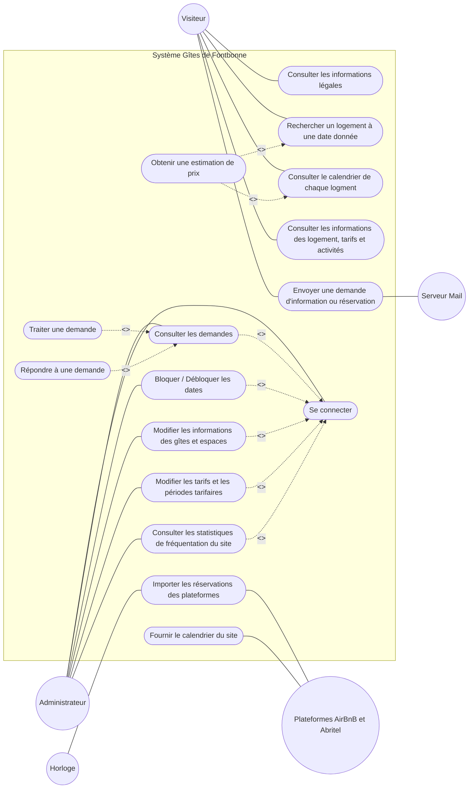
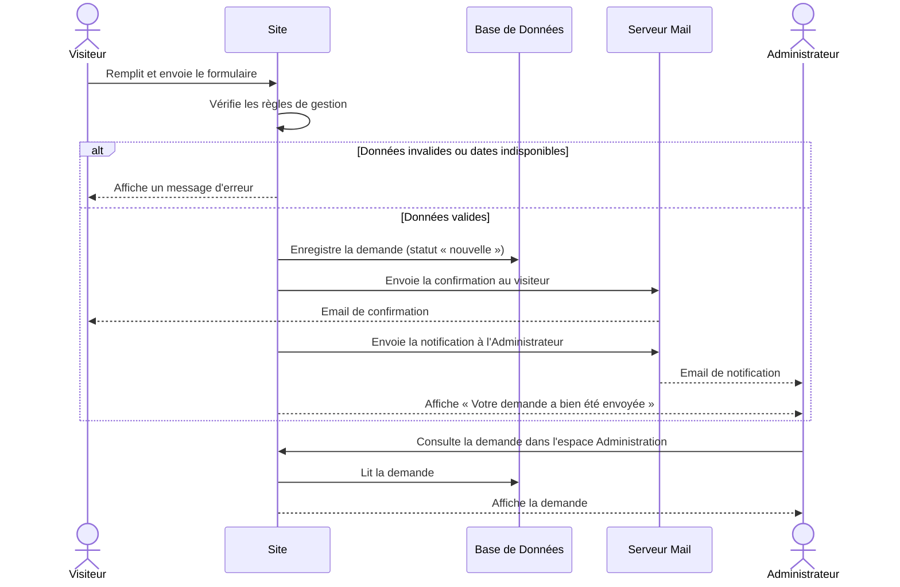

# Cahier des charges fonctionnel

>Cartes du projet : [#1](https://github.com/Milie07/gites-de-fontbonne/issues/1), [#2](https://github.com/Milie07/gites-de-fontbonne/issues/2), [#3](https://github.com/Milie07/gites-de-fontbonne/issues/3)

---

## Sommaire
1. [Contexte](#1-contexte)
2. [Analyse de l'existant](#2-analyse-de-lexistant)
3. [Besoins et Objectifs](#3-besoins-et-objectifs)
4. [Périmètre](#4-périmètre)
5. [Acteurs (v1)](#5-acteurs-v1)
6. [Exigences Fonctionnelles (v1)](#6-exigences-fonctionnelles-v1)
7. [Exigences non fonctionnelles](#7-exigences-non-fonctionnelles)
8. [Règles de gestion (v1)](#8-règles-de-gestion-v1)
9. [User Stories](#9-user-stories)
10. [Diagrammes](#10-diagrammes)
11. [Validation](#11-validation)
    
---

## 1. Contexte
  ### 1.1 L'entreprise et les gîtes
L'EURL « Les Sources de Fontbonne » exploite "les Gîtes de Fontbonne" : 3 gîtes de vacances regroupés dans le hameau de Fontbonne, au cœur de l'Ardèche verte.

Les 3 gîtes sont indépendants. Chacun dispose de 5 couchages et est entièrement équipé pour que les vacanciers soient autonomes. Ils partagent une piscine extérieure, une salle de jeux et un espace spa équipé d'un sauna et d'un jacuzzi.

Une chambre avec salle d'eau (douche et toilettes) peut être louée en complément de l'un des gîtes. Elle n'est pas réservable seule et n'apparaît pas sur les plateformes de location.

Les propriétaires vivent sur place, à l'entrée du hameau, ce qui laisse aux vacanciers l'impression d'être seuls à Fontbonne.

  ### 1.2 La clientèle
Les vacanciers sont pour la plupart des familles, des groupes d'amis, des randonneurs ou des vététistes. Il arrive aussi qu'un seul groupe loue l'ensemble des gîtes pour se retrouver.

Ils recherchent avant tout la déconnexion, la tranquillité et la nature. Ils réservent en général pour un week-end ou à la semaine.

  ### 1.3 La présence en ligne actuelle
Le site www.gitesdefontbonne.com a été créé en 2012 par les anciens propriétaires avec WordPress, et il est hébergé chez Ionos. Les propriétaires actuels l'ont ensuite mis à jour.

Les Gîtes de Fontbonne sont aujourd'hui visibles en ligne par 3 canaux :

- le site WordPress gitesdefontbonne.com ;
- les annonces Airbnb et Abritel ;
- une fiche d'établissement Google, qui affiche la note de 5/5 sur 13 avis (novembre 2026) et dirige les visiteurs vers le site.

La refonte doit préserver cette visibilité : le lien de la fiche Google vers le site, la cohérence des informations (nom, adresse, téléphone) et le référencement existant.

[↑ Haut de page](#cahier-des-charges-fonctionnel)

---

## 2. Analyse de l'existant
  ### 2.1 Constats sur le site actuel (réalisé en novembre 2026)

Audit PageSpeed Insights du 12/11/2026 :

| | Performance | Accessibilité | Bonnes pratiques | SEO |
|---|---|---|---|---|
| Ordinateur | 88 | 87 | 69 | 92 |
| Mobile | 50 | 88 | 69 | 92 |

- Sur mobile, l'élément principal de la page s'affiche en 91,4 s (seuil « bon » de Google : 2,5 s).
- La page d'accueil pèse environ 33 Mo, surtout à cause d'images non optimisées.
- 32 ressources sont chargées sans connexion sécurisée, et aucun en-tête de sécurité n'est en place.
- Les contrastes sont insuffisants et certains liens n'ont pas de nom accessible.
- Les pages n'ont pas de méta-description.
- Le tableau des tarifs s'affiche mal, sur mobile comme sur ordinateur.
- Le site n'a pas d'identité visuelle : fond blanc, texte noir et photos.
- Aucun calendrier n'affiche les disponibilités des gîtes en lien avec Airbnb et Abritel.

  ### 2.2 Pourquoi changer :
- **Des visiteurs perdus sur mobile** :

Avec un affichage de plus d'une minute sur une connexion mobile lente, un visiteur repart avant d'avoir vu les logements. Ce sont autant de demandes de réservation en moins.
- **Un référencement fragilisé** :

Google classe les sites principalement d'après leur version mobile. La lenteur et l'absence de méta-description pénalisent la visibilité, malgré un score SEO technique correct.
- **Un risque pour la sécurité et la réputation** :

Ressources non sécurisées, absence d'en-têtes de sécurité, failles fréquentes dans les extensions WordPress : le site peut exposer les données des visiteurs et nuire à l'image des gîtes.
- **Des visiteurs exclus** :

Les contrastes insuffisants et les liens sans nom rendent le site difficile à utiliser pour les personnes malvoyantes ou utilisant un lecteur d'écran.
- **Une image qui ne reflète pas celle des gîtes** :

Un site sans identité visuelle et un tableau des tarifs illisible ne donnent pas envie de réserver.

[↑ Haut de page](#cahier-des-charges-fonctionnel)

---

## 3. Besoins et objectifs
  ### 3.1 Besoins du client
L'EURL « Les Sources de Fontbonne » souhaite disposer d'un site et d'un espace d'administration permettant de :

- refléter l'image du lieu grâce à une identité visuelle propre ;
- présenter chaque logement (gîtes et chambre) avec un descriptif, des photos, un tarif moyen) ;
- afficher les tarifs selon les périodes ;
- afficher, pour chaque logement, un calendrier des disponibilités synchronisé avec Airbnb et Abritel ;
- estimer le prix d'un séjour selon les dates choisies ;
- recevoir des demandes d'informations ou de réservation par message ;
- gérer en autonomie, sans intervention technique, les informations des logements (textes, photos, tarifs) (souhaitable pour la première version) ;
- suivre la fréquentation du site ;
- être trouvé facilement sur Google et consultable rapidement sur mobile, y compris par les personnes en situation de handicap.

  ### 3.2 Objectifs de la refonte
L'objectif principal est de créer un site moderne, performant et accessible, qui permette au visiteur de trouver rapidement l'information qu'il recherche.

  1. Un site rapide sur mobile : élément principal affiché en moins de 2,5 s ;
  2. Un site sécurisé et maîtrisé, sans dépendance à des extensions tierces ; 
  3. Un site accessible : contrastes conformes, éléments correctement nommés ;
  4. Une identité visuelle propre aux Gîtes de Fontbonne ;
  5. Des tarifs et des disponibilités clairs, à jour et lisibles sur tout écran ;
  6. Un référencement préservé pendant la migration, puis amélioré ;

  ### 3.3 Contraintes
- **Synchronisation des calendriers** : les plateformes mettent à jour leurs calendriers toutes les deux heures environ. Les disponibilités affichées seront donc indicatives et confirmées par le propriétaire ;
- **Hébergement** : le site reste hébergé chez Ionos, où se trouve déjà le nom de domaine ;
- **Délai** : mise en ligne avant fin février 2027, avant la saison ;
- **Réglementation** : RGPD et mentions légales ;

[↑ Haut de page](#cahier-des-charges-fonctionnel)

---

## 4. Périmètre 

  ### 4.1 Première version
Les besoins listés dans la partie **Besoins du Client**

  ### 4.2 Évolutions envisagées (hors périmètre de la première version)
+ Réservation directe en ligne ;
+ Création des contrats de location depuis l'espace admin et envoi au locataire ;
+ Mise à disposition des documents d'arrivée : livret d'accueil, règlement intérieur, informations sur la taxe de séjour ;
+ Paiement en ligne, avec envoi automatique des e-mails d'acompte, de solde et de confirmation de réception ;
+ Avec la réservation en ligne : conditions générales de vente complètes (paiement, annulation, absence de droit de rétractation pour une location à date fixe, médiation de la consommation) ;

[↑ Haut de page](#cahier-des-charges-fonctionnel)

---

## 5. Acteurs (v1)
| Acteur	| Description |
|---|---|
| **Visiteur**	| Personne qui consulte le site : découvre les gîtes, vérifie les disponibilités, estime un prix, envoie une demande |
| **Administrateur**	| Propriétaire des gîtes : gère les demandes, les tarifs et les informations du site |
| **Airbnb et Abritel**	| Systèmes externes : fournissent les calendriers de réservation au format iCal |
| **Serveur mail**	| Système externe : achemine les e-mails de demande et de confirmation |

[↑ Haut de page](#cahier-des-charges-fonctionnel)

## 6. Exigences fonctionnelles (v1)

| N° | Domaine | Exigence | Priorité |
|---|---|---|---|
| EX-01 | Présentation | Le visiteur peut consulter chaque gîte et la chambre : descriptif, photos, capacité, équipements. | M |
| EX-02 | Présentation | Le visiteur peut consulter les activités sur place : piscine, salle de jeux, spa. | M |
| EX-03 | Présentation | Le visiteur peut consulter les activités à proximité. | M |
| EX-04 | Présentation | Le visiteur peut consulter les tarifs à la nuitée. | M |
| EX-05 | Présentation | L'administrateur peut modifier les informations et les photos des logements et des espaces communs. | M |
| EX-06 | Disponibilités | Le visiteur peut consulter le calendrier des disponibilités de chaque logement. | M |
| EX-07 | Disponibilités | Le visiteur peut choisir d'afficher de 1 à 4 calendriers en même temps. | M |
| EX-08 | Disponibilités | Le visiteur peut rechercher les logements disponibles pour des dates données. | S |
| EX-09 | Disponibilités | Le site importe automatiquement les réservations Airbnb et Abritel de chaque gîte. | M |
| EX-10 | Disponibilités | Le site exporte ses propres blocages vers Airbnb et Abritel. | S |
| EX-11 | Disponibilités | Les adresses iCal des gîtes sont configurées en dehors du code source (variables d'environnement) | M |
| EX-12 | Disponibilités | L'administrateur peut bloquer et débloquer des dates pour chaque logement. | M |
| EX-13 | Tarifs | Le visiteur peut obtenir une estimation du prix pour un ou plusieurs logements et des dates choisis. | M |
| EX-14 | Tarifs | L'administrateur peut gérer les tarifs et les périodes tarifaires. | M |
| EX-15 | Demandes | Le visiteur peut envoyer une demande d'information ou de réservation pour un ou plusieurs logements, via un formulaire. | M |
| EX-16 | Demandes | Le visiteur reçoit un e-mail de confirmation de réception de sa demande. | M |
| EX-17 | Demandes | Le visiteur reçoit un e-mail de confirmation de réservation. | M |
| EX-18 | Demandes | L'administrateur est averti par e-mail de chaque nouvelle demande. | M |
| EX-19 | Demandes | L'administrateur peut consulter les demandes et modifier leur statut. | M |
| EX-20 | Demandes | L'administrateur peut répondre à une demande par e-mail depuis l'espace d'administration. | S |
| EX-21 | Administration | L'administrateur peut se connecter à l'espace d'administration et s'en déconnecter. | M |
| EX-22 | Suivi | L'administrateur peut consulter les statistiques de fréquentation du site. | S |
| EX-23 | Légal | Le visiteur peut consulter les mentions légales depuis chaque page. | M |
| EX-24 | Légal | Le visiteur peut consulter la politique de confidentialité depuis chaque page. | M |
| EX-25 | Légal | Le visiteur peut consulter les conditions générales de location. | M |
| EX-26 | Légal | Le visiteur peut consulter une page Accessibilité indiquant comment signaler un problème. | S |

[↑ Haut de page](#cahier-des-charges-fonctionnel)

## 7. Exigences non fonctionnelles

| N° | Catégorie | Exigence | Vérification | Objectif |
|---|---|---|---|---|
| ENF-01 | Performance | Sur mobile, l'élément principal de chaque page s'affiche en moins de 2,5 s. | PageSpeed Insights (LCP) | 1 |
| ENF-02 | Performance | Le score de performance PageSpeed est d'au moins 90 sur mobile et sur ordinateur, en moyenne sur 3 mesures. | PageSpeed Insights | 1 |
| ENF-03 | Performance | La page d'accueil pèse moins de 2 Mo. | Outils de développement du navigateur | 1 |
| ENF-04 | Performance | Les images sont redimensionnées, converties en WebP et chargées au fil du défilement. | Inspection du code, audit | 1 |
| ENF-05 | Compatibilité | Le site s'adapte à toutes les tailles d'écran, du mobile (320 px) à l'ordinateur. | Tests sur plusieurs tailles d'écran | 5 |
| ENF-06 | Compatibilité | Le site fonctionne sur les dernières versions de Chrome, Firefox, Safari et Edge. | Tests manuels | 5 |
| ENF-07 | Accessibilité | Le texte a un contraste d'au moins 4,5:1 avec son fond. | Audit PageSpeed + vérification manuelle | 3 |
| ENF-08 | Accessibilité | Chaque image a un texte alternatif, chaque lien et chaque bouton un nom explicite. | Audit + lecteur d'écran | 3 |
| ENF-09 | Accessibilité | Tout le site est utilisable au clavier seul. | Test manuel | 3 |
| ENF-10 | Accessibilité | Le score d'accessibilité PageSpeed est d'au moins 90, en complément des vérifications manuelles. | PageSpeed Insights | 3 |
| ENF-11 | Sécurité | Toutes les pages et ressources sont servies en HTTPS. | Audit (aucun contenu mixte) | 2 |
| ENF-12 | Sécurité | Le site applique les en-têtes de sécurité recommandés (détail dans le cahier des charges technique). | Audit | 2 |
| ENF-13 | Sécurité | Les mots de passe sont hachés et les tentatives de connexion sont limitées. | Tests de sécurité | 2 |
| ENF-13b | Sécurité | Les formulaires sont protégés contre le CSRF et limités en nombre d'envois, avec une protection contre les robots. | Tests de sécurité | 2 |
| ENF-13c | Sécurité | Les requêtes en base utilisent des requêtes préparées (protection contre l'injection SQL) et les contenus affichés sont échappés (protection contre le XSS). | Tests de sécurité, relecture du code | 2 |
| ENF-14 | Sécurité | Aucun secret (mot de passe, clé, ical) n'apparaît dans le dépôt public. | Vérification du dépôt | 2 |
| ENF-15 | Référencement | Chaque page a un titre et une méta-description uniques. | Audit SEO | 6 |
| ENF-16 | Référencement | Les anciennes adresses du site redirigent vers les nouvelles (redirection 301). | Test des URL du plan de référencement | 6 |
| ENF-17 | Référencement | Le site fournit un sitemap.xml, un robots.txt et des données structurées. | Search Console, outil de test Google | 6 |
| ENF-18 | Données personnelles | Le visiteur donne son accord avant l'envoi de sa demande ; les données sont conservées pendant une durée définie de 7 jours. | Test du formulaire, vérification de la suppression | 2 |
| ENF-19 | Données personnelles | La mesure d'audience ne dépose pas de traceur soumis à consentement (Matomo configuré selon la CNIL). | Outils de développement, guide Matomo/CNIL | 2 |
| ENF-20 | Fraîcheur des données | Les calendriers Airbnb et Abritel sont importés au moins toutes les heures. | Journal des imports | 5 |
| ENF-21 | Sauvegarde | Base de données sauvegardée chaque jour, images à chaque modification, copie hors de l'hébergement chaque semaine (règle 3-2-1) ; restauration testée chaque trimestre. | Procédure et journal de restauration | 2 |
| ENF-22 | Maintenabilité | Le code est versionné, documenté, et le site s'installe en local avec Docker sur Mac et sur PC. | README, test d'installation | 2 |
| ENF-23 | Évolutivité | Le modèle de données permet d'ajouter plus tard un espace client sans refonte (rôles utilisateur, entité Client). | Relecture du MCD | — |
| ENF-24 | Éco-conception | Seules les ressources utiles sont chargées : pas de bibliothèque ou de script inutile. | Audit (code inutilisé) | 1 |
| ENF-25 | Performance | Le site supporte au moins 20 visiteurs simultanés sans ralentissement notable. | Test de charge simple | — (priorité basse) |

[↑ Haut de page](#cahier-des-charges-fonctionnel)

## 8. Règles de gestion (v1)
| N° | Règle |
|---|---|
| RG-01 | Une demande porte sur un ou plusieurs gîtes. |
| RG-02 | La chambre supplémentaire ne peut être demandée qu'avec au moins un gîte. |
| RG-03 | Une demande ne peut porter que sur des dates disponibles pour tous les logements demandés. |
| RG-04 | Un gîte est indisponible s'il est réservé sur une plateforme ou bloqué par l'administrateur. La chambre, absente des plateformes, n'est bloquée que par l'administrateur. |
| RG-05 | La date de départ doit être postérieure à la date d'arrivée. |
| RG-06 | LUne demande ne peut porter que sur des dates futures. |
| RG-07 | Un séjour dure au minimum 2 nuits, s'il comprend au moins une nuit de la période Vacances d'été, il dure au minimum 7 nuits. |
| RG-08 | Une arrivée pendant la périodes Vacances d'été se fait le samedi uniquement. |
| RG-09| Un départ pendant la périodes Vacances d'été se fait le samedi uniquement. |
| RG-10 | Chaque nuit est facturée au tarif de la période qui contient sa date ; Un séjour à cheval sur deux périodes cumule les deux tarifs. |
| RG-11 | Un séjour dure au maximum 21 nuits. |
| RG-12 | Un gîte accueille au maximum 5 personnes, bébés non compris (lits bébé disponibles). |
| RG-13 | La chambre supplémentaire accueille au maximum 2 personnes, bébés non compris. |
| RG-14 | Une demande a un statut : nouvelle, traitée, acceptée ou refusée. |
| RG-15 | Les tarifs sont à la nuitée sont sans ménage ni location de draps. |
| RG-16 | Le prix affiché lors de la sélection de dates est une estimation et ne vaut pas confirmation. |
| RG-17 | Le ménage et la location des draps sont inclus dans le prix affiché lors de la sélection de dates. |
| RG-18 | Le prix affiché n'inclut pas la taxe de séjour ; une mention l'indique. |
| RG-19 | La taxe de séjour est calculée à la réservation, selon le nombre de personnes et de nuits. |
| RG-20 | Seul l'administrateur peut modifier les tarifs, les périodes tarifaires, les blocages et les informations des logements. |
| RG-21 | La durée de vie d'une demande est de 7 jours. |

Règles tarifaires : voir regles-tarifaires.md.

[↑ Haut de page](#cahier-des-charges-fonctionnel)

## 9. User stories
   ### 9.1 Récapitulatif
| N° | Acteur | User Story |  Priorité | Exigences |
|---|---|---|---|---|
| US-01	| Visiteur | Consulter les informations des logements et des activités | M | EX-01 - EX-02 - EX-03 |
| US-02	| Visiteur | Consulter les tarifs d'un logement  | M | EX-04 |
| US-03	| Visiteur | Consulter les disponibilités d'un ou plusieurs logements | M | EX-06 - EX-07 - EX-09 |
| US-04	| Visiteur | Consulter les disponibilités d'un ou plusieurs logements pour des dates données | M | EX-08 |
| US-05	| Visiteur | Estimer le prix d'un ou plusieurs logements pour une période donnée | M | EX-13 |
| US-06	| Visiteur | Envoyer une demande de réservation pour un ou plusieurs logements pour une période donnée | M | EX-15 - EX-16 |
| US-07	| Visiteur | Consulter les mentions légales | M | EX-23 - EX-24 - EX-25 |
| US-08	| Visiteur | Consulter l'accessibilité | S | EX-26 |
| US-09	| Administrateur | Se connecter / déconnecter de l'espace administration | M | EX-21 |
| US-10	| Administrateur | Consulter les statistiques de visite du site | S | EX-22 |
| US-11	| Administrateur | Recevoir et traiter les demandes de visiteurs | M | EX-18 - EX-19 - EX-17|
| US-12	| Administrateur | Répondre aux demandes de visiteurs | S | EX-20 |
| US-13 | Administrateur | Gérer les tarifs et les périodes tarifaires | M | EX-14 |
| US-14 | Administrateur | Modifier les textes et les photos des logements et des espaces communs | M | EX-05 |
| US-15 | Administrateur | Bloquer et débloquer des dates pour un logement | M | EX-12 |
| US-16 | Administrateur | Transmettre les dates bloquées à Airbnb et Abritel | S | EX-10 |

   ### 9.2 User stories détaillées
#### US-01 : Consulter les informations des logements et des activités

> **En tant que** visiteur,
> **je veux** consulter les informations des logements, des espaces communs et des activités,
> **afin de** savoir si les gîtes et / ou la chambre correspondent aux vacances que je souhaite.

**Priorité :** M · **Exigences :** EX-01, EX-02, EX-03 · **Règles de gestion :** RG-02, RG-08, RG-09

**Critères d'acceptation**

1. Pour chaque gîte, le visiteur voit le descriptif, les photos, la capacité et les équipements.
2. La capacité indique 5 personnes par gîte, bébés non compris, avec des lits bébé disponibles.
3. La chambre est présentée avec sa capacité (2 personnes) et la mention qu'elle se loue uniquement avec un gîte.
4. Le visiteur voit les activités sur place (piscine, salle de jeux, spa), avec des photos.
5. Le visiteur voit les activités à proximité.
6. Ces informations sont accessibles depuis le menu, sur chaque page.
7. Les photos s'affichent correctement sur mobile et sur ordinateur, et chacune a un texte alternatif.

#### US-02 : Consulter les tarifs des logements

> **En tant que** visiteur,
> **je veux** consulter les tarifs des logements
> **afin de** savoir si le prix des gîtes et ou de la chambre correspondent au budget vacances que j'ai prévu.

**Priorité :** M · **Exigences :** EX-04 · **Règles de gestion :** RG-02, RG-08, RG-09, RG-11

**Critères d'acceptation**

1. Pour chaque gîte, le visiteur voit le tarif suivant la période tarifaire.
2. La mention du prix du forfait ménage obligatoire est présente.
3. La mention du prix des draps par personne obligatoire est présente.
4. La mention précisant que la nuitée est indiquée hors ménage et draps.
5. La mention de la taxe de séjour en sus est présente.
6. Les durées minimales et maximales de séjour sont précisées.
7. Ces informations sont accessibles depuis le menu, sur chaque page.
8. Les tableaux de tarifs sont responsives et s'affichent correctement.

#### US-03 : Consulter les disponibilités des logements

> **En tant que** visiteur,
> **je veux** consulter les disponibilités d'un ou plusieurs logements,
> **afin de** choisir les dates de mon séjour.

**Priorité :** M · **Exigences :** EX-06, EX-07, EX-09 · **Règles de gestion :** RG-04

**Critères d'acceptation**

1. Le visiteur peut consulter le calendrier de chaque logement : les 3 gîtes et la chambre.
2. Il peut choisir d'afficher 1, 2, 3 ou 4 calendriers en même temps.
3. Les dates réservées sur Airbnb ou Abritel apparaissent comme indisponibles.
4. Les dates bloquées par l'administrateur apparaissent comme indisponibles, y compris pour la chambre.
5. Les dates disponibles et indisponibles se distinguent autrement que par la couleur seule (légende, motif ou texte).
6. Le visiteur peut passer au mois précédent ou suivant ; les dates passées ne sont pas proposées.
7. Une mention indique que les disponibilités sont indicatives et confirmées par le propriétaire.
8. Si l'import d'une plateforme échoue, le calendrier affiche les dernières disponibilités connues, et l'administrateur est averti.
9. Les calendriers sont accessibles depuis le menu, sur chaque page.
10. Les calendriers s'adaptent à la taille de l'écran : sur mobile, ils s'affichent les uns sous les autres.
11. Les calendriers sont utilisables au clavier.

**Scénarios de validation**

**Méthode Gherkin**
```gherkin
Fonctionnalité: Consulter les disponibilités
  Scénario: Afficher plusieurs calendriers
    Étant donné que je suis sur la page des disponibilités
    Quand je sélectionne deux gîtes et la chambre
    Alors trois calendriers s'affichent en même temps

  Scénario: Une réservation Airbnb rend des dates indisponibles
    Étant donné qu'un gîte est réservé sur Airbnb du 10 au 17 juillet 2027
    Et que l'import des calendriers a eu lieu
    Quand je consulte le calendrier de ce gîte
    Alors les dates du 10 au 16 juillet 2027 apparaissent indisponibles

  Scénario: Un blocage de la chambre rend des dates indisponibles
    Étant donné que l'administrateur a bloqué la chambre du 1er au 5 août 2027
    Quand je consulte le calendrier de la chambre
    Alors ces dates apparaissent indisponibles
​
```
#### US-04 : Consulter les disponibilités des logements par dates

> **En tant que** visiteur,
> **je veux** consulter les disponibilités d'un ou plusieurs logements à la date choisie sur le calendrier
> **afin de** m'assurer qu'ils sont disponibles au moment souhaité.

**Priorité :** M · **Exigences :** EX-06, EX-07, EX-08, EX-09 · **Règles de gestion :** RG-04, RG-05, RG-06, RG-07

**Critères d'acceptation**

1. Le visiteur peut renseigner une date d'arrivée et de départ.
2. il voit les disponibilités aux dates choisies sur 1, 2 3 ou 4 calendriers.
3. Si les dates choisies chevauchent des dates bloqués ou indisponibles, un message s'affiche pour dire que la réservation sur ces dates n'est pas possible.
4. Si les dates choisies sont disponibles, la réservation est possible.

[↑ Haut de page](#cahier-des-charges-fonctionnel)

---

## 10. Diagrammes
  ### 10.1 Diagramme de cas d'utilisation #3



  ### 10.2 Diagramme de séquence 
**Demande de réservation** 



## 11. Validation
| Date |	Validé par	| Remarques |
|---|---|---|
| | | |

[↑ Haut de page](#cahier-des-charges-fonctionnel)