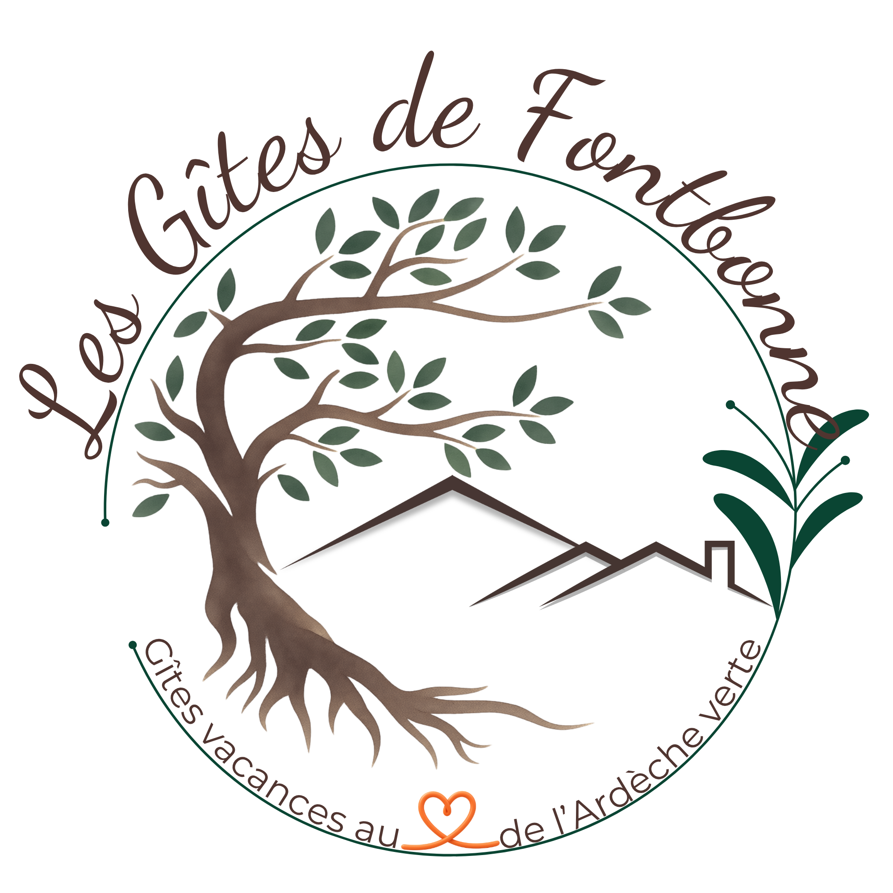
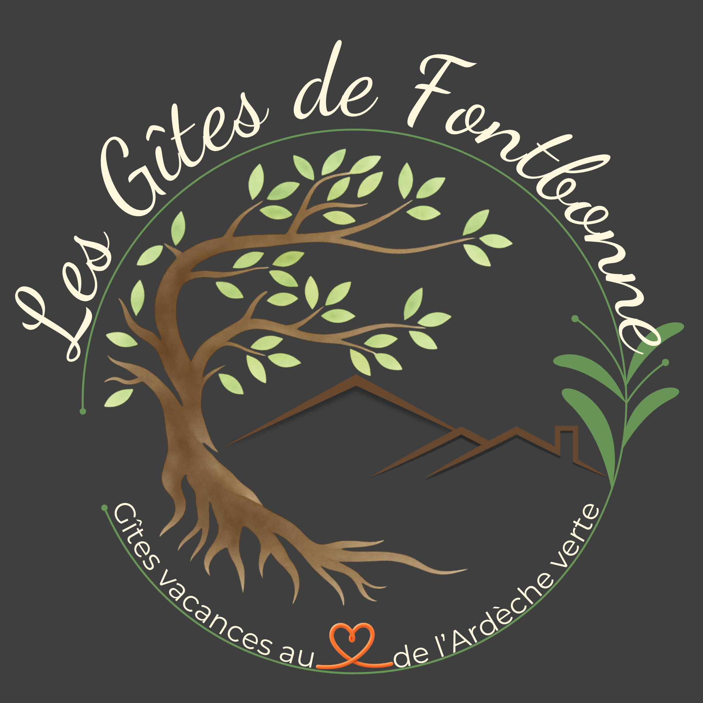
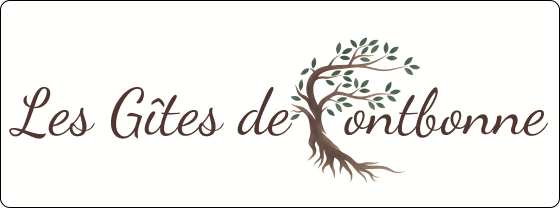
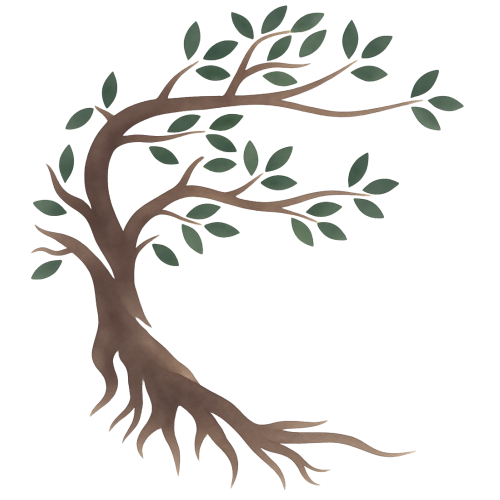
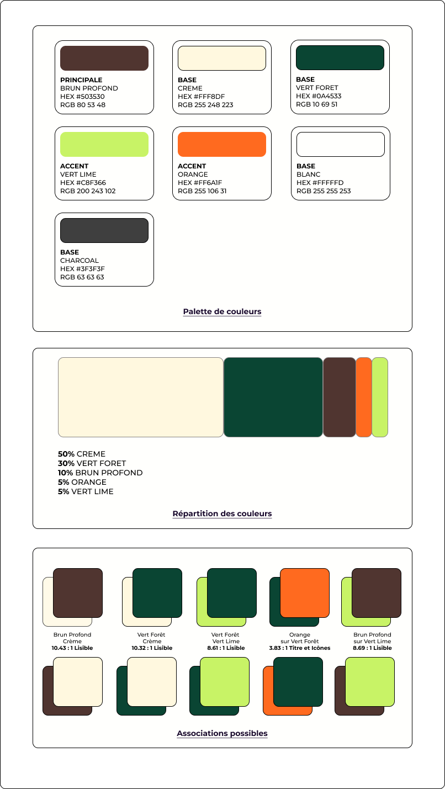
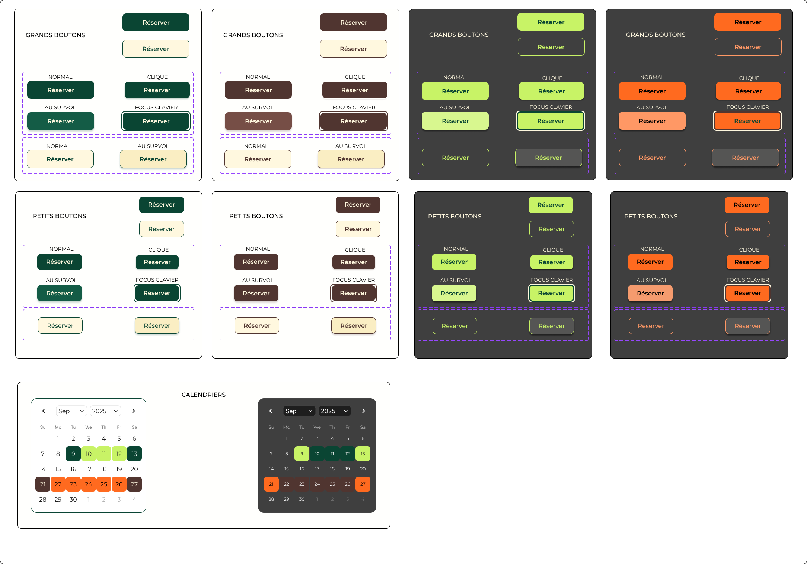
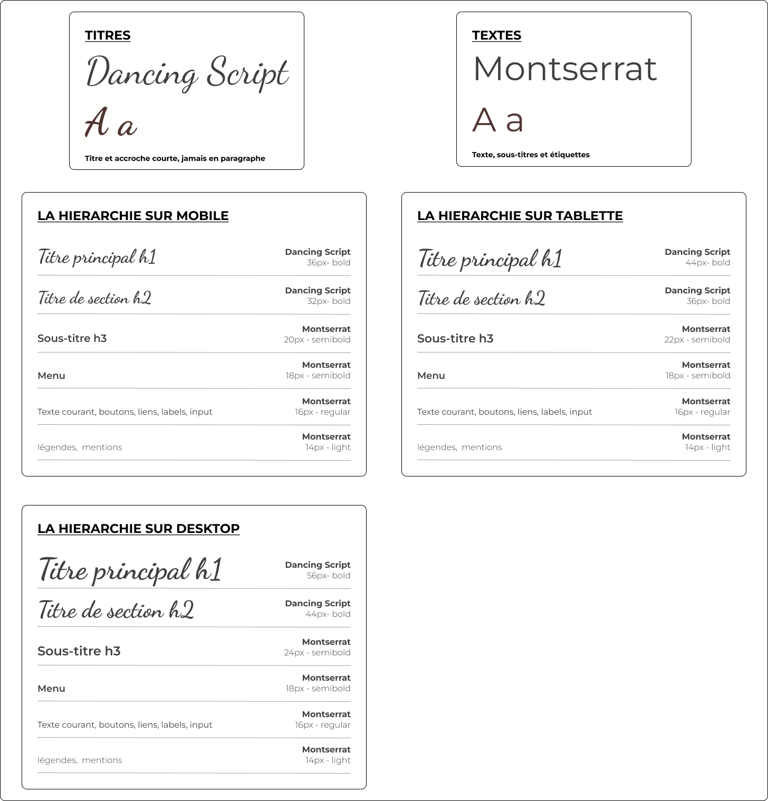

# Charte graphique
---
> Cartes : [#4](https://github.com/Milie07/gites-de-fontbonne/issues/4)

## Intentions
Les gîtes de Fontbonne sont trois gîtes en pierre dans un hameau de montagnes ardéchoises. Le site doit donner envie de déconnecter en mettant en avant la nature, le calme, la chaleur de la pierre et du bois et la convivialité. Les valeurs à transmettre sont :
- **L'authenticité** : la pierre, le bois, les arbres, le patrimoine;
- **La nature et la sérénité** : la forêt, la montagne, le vert sous toutes ses formes;
- **L'accueil chaleureux** : une base crème et brune, des titres manuscrits;
- **La vitalité** : des touches de vert lime et orange pour les actions et les points d'attention;
- **La confiance et l'accessibilité** : les informations claires, des contrastes vérifiés, un site utilisable par tous en mode clair comme en mode sombre;

## Logo

Le logo représente un arbre aux racines apparentes, avec les toits du hameau et le slogan "Gîtes Vacances au ❤️ de l'Ardèche Verte".
| Déclinaisons | Usage |
|:---:|---|
|  | Accueil, pied de page, documents imprimés |
|  | Mode sombre, supports sur fond fonçé |
|  | En-tête du site (format horizontal) |
|  | Favicon, icône d'application, petits espaces |

**Les Règles d'usage** :
- Utiliser la version fond clair sur Crème ou Bland et la version fonçée sur Charcoal.
- En dessous d'une certaine largeur le slogan devient illisible : il convient d'utiliser le logo texte seul ou l'icône seule.
- Toujours fournir un texte alternatif (alt="Les Gîtes de Fontbonne").

**Le Favicon** :
Le Favicon reprend l'icône seule en version claire et fonçée.

| Fichier | Taille | Usage |
|---|---|---|
| `favicon-fond-clair.svg` | vectoriel | Navigateurs récents |
| `favicon.ico` | 32 x 32 | Navigateurs plus anciens |
| `apple-touch-icon.png` | 180 x 180, fond plein clair | Ecrans d'accueil iPhone / iPad |

Fichier source en 512 x 512

## Couleurs
| Rôle | Nom | Code hexadécimal | Usage |
|---|---|---|---|
| Principale | Brun profond | #503530 | Texte courant, titres en mode clair, cases du calendrier (non dispo) |
| Base | Crème | #FFF8DF | Fond principal (mode clair), texte en mode sombre |
| Base | Vert forêt | #0A4533 | Boutons principaux (mode clair), grands aplats, cases du calendrier (dispo) | 
| Base | Blanc | #FFFFFD | Fond de cartes, calendrier | 
| Base | Charcoal | #3F3F3F | Fond principal (mode sombre), calendrier | 
| Base | Charcoal clair | #555554 | Etat hover des boutons principaux fond Charcoal et contour Vert Lime et Orange | 
| Accent | Vert Lime | #C8F366 | Boutons principaux (mode sombre), mise en avant, points d'attention, titres et /ou icônes | 
| Accent | Vert Lime clair | #D8F78F| Etat hover des boutons principaux fond Vert Lime | 
| Accent | Orange | #FF6A1F | Boutons principaux (mode sombre), mise en avant, points d'attention, titres et /ou icônes | 
| Accent | Orange Clair | #FF9865| Boutons principaux (contours en mode sombre), icônes, état hover en mode sombre des boutons principaux font Orange | 

## Contrastes

Seuils WCAG 2.2, niveau AA testé sur webaim.org 
| Texte | Fond | Ratio | Conforme (≥ 4,5:1) |
|---|---|---|---|
| Brun profond #503530 | Crème #FFF8DF | 10.43:1 | Oui (AAA) |
| Brun profond #503530 | Blanc #FFFFFD | 11.07:1 | Oui (AAA) |
| Brun profond #503530 | Vert Lime #C8F366 | 8.69:1 | Oui (AAA) |
| Vert forêt #0A4533 | Crème #FFF8DF | 10.32:1 | Oui (AAA) |
| Vert forêt #0A4533 | Vert Lime #C8F366 | 8.61:1 | Oui (AAA) |
| Blanc #FFFFFD | Vert forêt #0A4533 | 10.97:1 | Oui (AAA) |
| Crème #FFF8DF | Charcoal #3F3F3F | 9.90:1 | Oui (AAA) |
| Vert Lime #C8F366 | Charcoal #3F3F3F | 8.25:1 | Oui (AAA) |
| Noir #000000 | Orange #FF6A1F | 7.33:1 | Oui (AAA) |
| Charcoal #3f3f3f| Orange Clair #FF9865 | 4.98:1 | Oui (AA) |
| Charcoal clair #555554 | Orange Clair #FF9865 | 3.52:1 | Composants d'interfaces |
| Orange #FF6A1F | Vert forêt #0A4533 | 3.83:1 | Titres et icônes seulement |
| Brun profond #503530 | Orange #FF6A1F | 3.87:1 | Titres et icônes seulement |
| Blanc #FFFFFD  | Orange #FF6A1F | 2.86:1 | Non |
| Crème #FFF8DF  | Orange #FF6A1F | 2.69:1 | Non |
| Brun profond #503530 | Charcoal #3F3F3F | 1.05:1 | Non |
| Vert forêt #0A4533 | Charcoal #3F3F3F | 1.04:1 | Non |
| Vert Lime #C8F366 | Crème #FFF8DF | 1.19:1 | Non |
| Vert Lime #C8F366 | Blanc #FFFFFD  | 1.27:1 | Non |

- Sur le Orange, le texte est toujours noir.
- En mode sombre, le texte est en crème ou en vert Lime sur Charcoal.
- Chaque association se vérifie en mode sombre et clair.

## Typographie
| Usage | Police | Rôle |
|---|---|---|
| Titres (H1, H2) | Dancing Script | Titres et accroches courtes |
| Textes courants | MontSerrat | Sous-titres (H3), menu, texte courant, boutons, liens, labels, inputs |

- Tailles exprimées en `rem` dans le code (16px = 1 rem)
- Les champs de formulaires restent à 16px
- Interligne du texte courant entre 1.5 et 1.6. 
- Polices hébergées sur le serveur plutôt que chargées depuis Google Fonts.
- Polices sous licence SIL Open Font License, open-source et gratuite (openfontlicense.org)

## Photos et icônes
**Les Photos** : 
- Vraies photos des gîtes, des équipements et du hameau : aucune utilisation de banque d'images.
- Format WepB, en plusieurs largeurs servies suivant la taille d'écran :
  - Bandeau d'accueil jusqu'à 1920px (⩽ 200 Ko);
  - Photos de contenus jusqu'à 1200px (⩽ 100 Ko);
  - Cartes des gîtes jusqu'à 800px (⩽ 80 Ko);
- Texte alternatif descriptif pour chaque photo informative et `alt=""`pour les photos décoratives.
- Pas de texte posé directement sur une photo sans voile ou fond contrasté.

**Les Icônes** :
- Icônes style au trait, homogènes avec un contraste d'au moins 3:1 et toujours accompagnés d'un libellé visible ou d'un `aria-label`.

## Composants
**Les Boutons**
Cahque bouton existe en mode clair et en mode sombre avec 4 états :
- Normal
- Survol
- Cliqué
- Focus (clavier)

| Bouton | Taille | Mode clair | Mode sombre |
|---|---|---|---|
| Grand bouton principal 1 | 180px x 48px | Fond Vert Forêt, texte Crème | Fond Vert Lime, texte Vert Forêt |
| Grand bouton principal 2 | 180px x 48px | Fond Brun profond, texte Crème | Fond Orange, texte Noir |
| Grand bouton secondaire 1 | 180px x 48px | Fond Crème, contour et texte Vert forêt | Fond Charcoal, contour et texte Vert Lime |
| Grand bouton secondaire 2 | 180px x 48px | Fond Crème, contour et texte Brun profond | Fond Charcoal, contour et texte Orange clair |
| Petit Bouton principal 1 | 120px x 44px | Fond Vert Forêt, texte Crème | Fond Vert Lime, texte Vert Forêt |
| Petit Bouton principal 2 | 120px x 44px | Fond Brun profond, texte Crème | Fond Orange, texte Noir |
| Petit Bouton secondaire 1 | 120px x 44px | Fond Crème, contour et texte Vert forêt | Fond Charcoal, contour et texte Vert Lime |
| Petit Bouton secondaire 2 | 120px x 44px | Fond Crème, contour et texte Brun profond | Fond Charcoal, contour et texte Orange clair |

**Les états** :
**Survol** : le bouton reste dans la même famille de couleur, un peu plus clair (principal) ou légèrement teinté (secondaire). Le texte garde un contraste d'au moins 4,5:1.
**Clic** : le bouton se réduit légèrement, comme s'il s'enfonçait.
**Focus clavier** : un contour décollé du bouton. La couleur est en fonction du bouton. Il n'apparaît qu'à la navigation au clavier (:focus-visible).
**Animations** : courtes (environ 150 ms) et désactivées si l'utilisateur a demandé à réduire les animations.

**Les Formulaires**
- Le libellé est visible au-dessus de chaque champ. Un placeholder ne remplace pas un libellé.
- Le texte saisi est à 16 px.
- Le contour des champs est contrasté d'au moins 3:1 avec le fond. Le focus est visible, comme pour les boutons.
- Les messages d'erreur sont en texte explicite, pas seulement en couleur.

**Les Calendriers de disponibilités**
- Calendrier disponible en mode clair et en mode sombre.
- Les cases utilisent la palette.
- Les jours et les mois sont en français (Lun, Mar…) et la semaine commençe le lundi ;
- Il y a un indicateur (à définir encore) autre que la couleur pour distinguer les dates disponibles des réservées et sélectionnées (motif, barré ou légende) ;

## Aperçu

